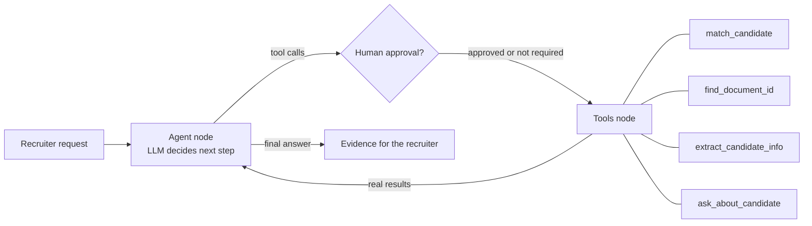
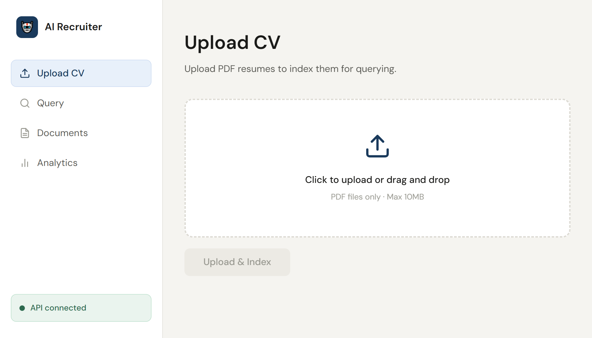
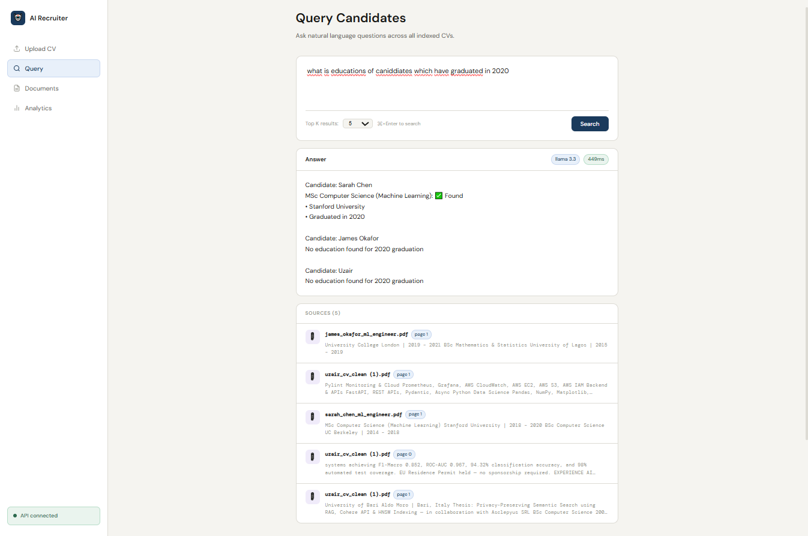
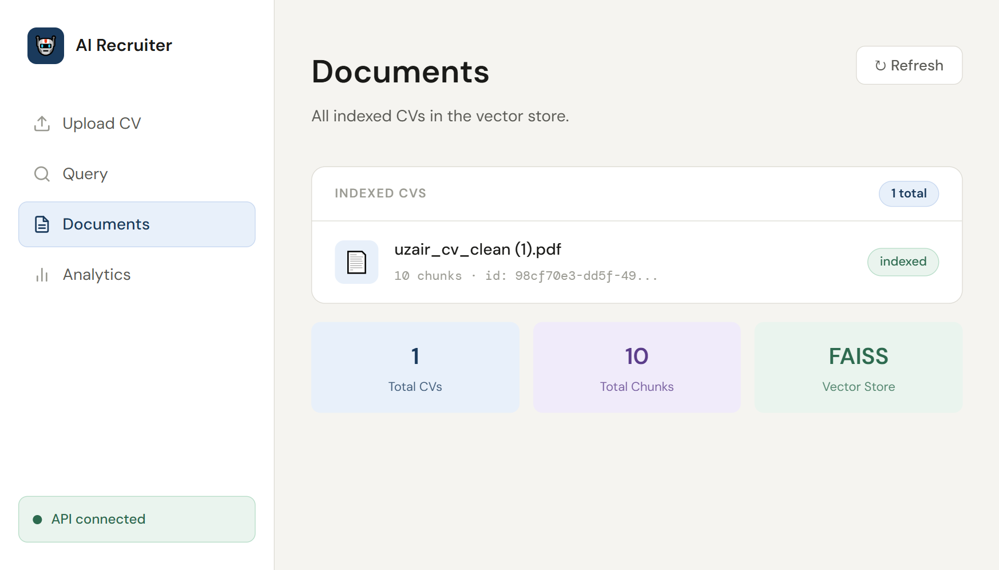
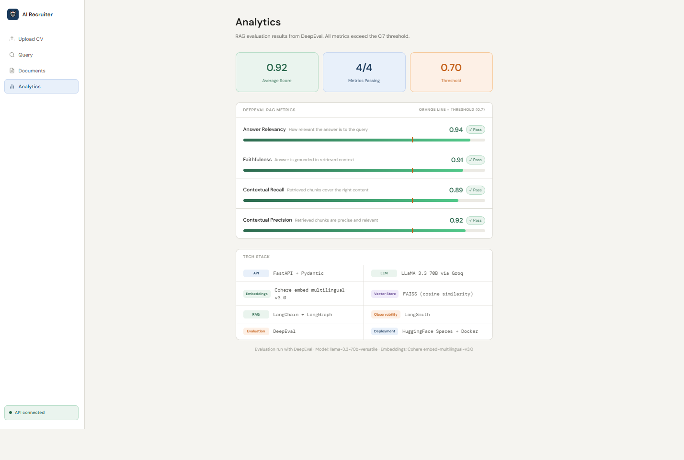
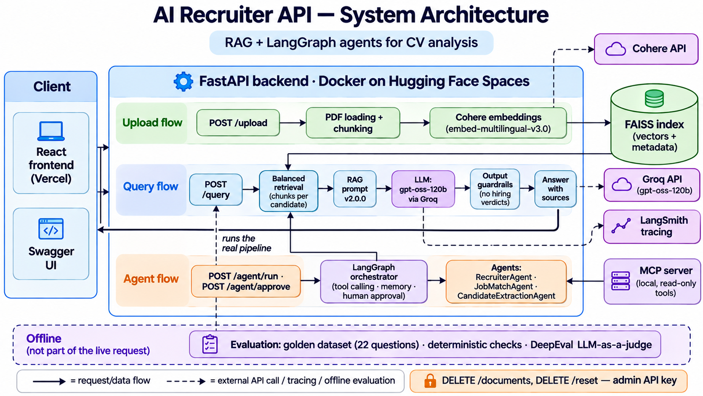
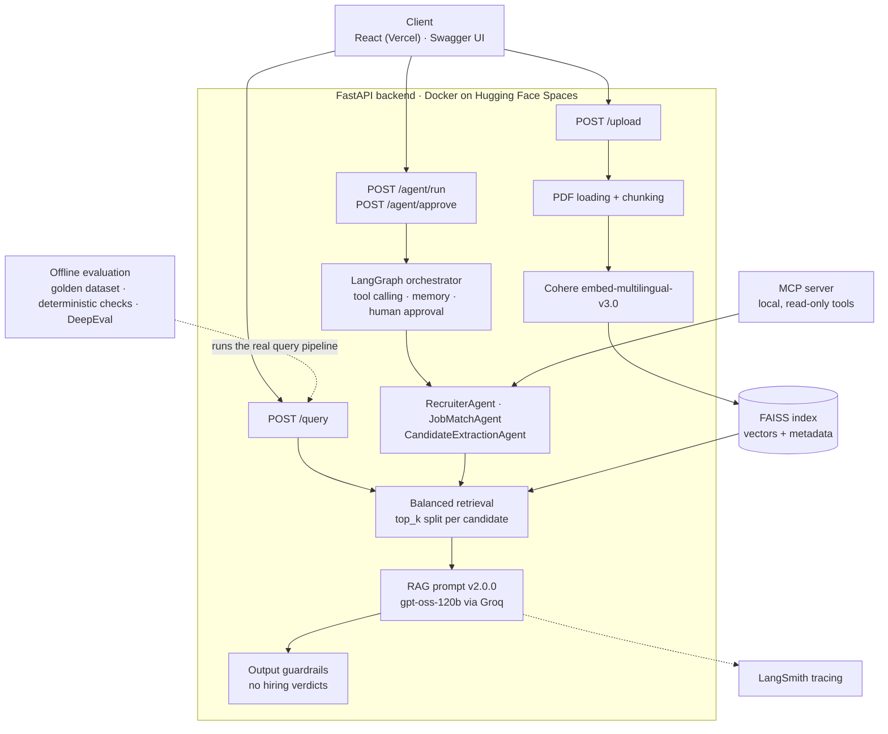
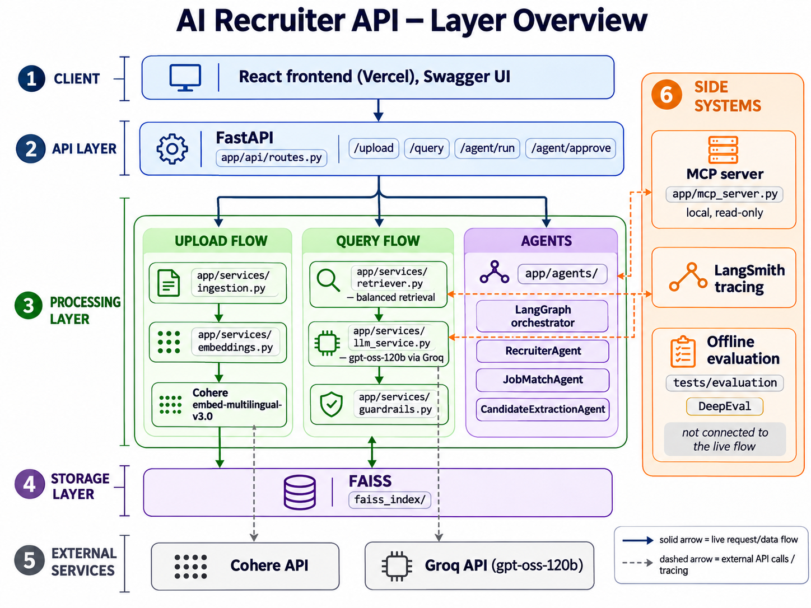
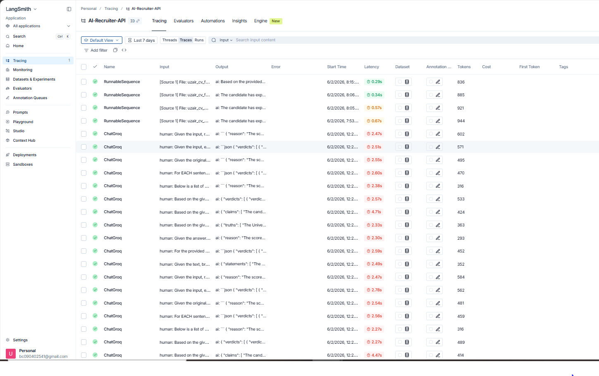

# 🤖 AI Recruiter API

<div align="center">


**Full-stack RAG + multi-agent system for CV analysis, candidate matching and recruiter Q&A**

[🎨 Live Frontend](https://ai-recruiter-frontend-khaki.vercel.app) · [🚀 Live API](https://huggingface.co/spaces/ozair1112/ai-recruiter-api) · [📖 API Docs](https://ozair1112-ai-recruiter-api.hf.space/docs) · [💼 Portfolio](https://uzairshafique.vercel.app)

> **Note:** Live demo runs on HuggingFace free tier. If the API shows offline, wait 30 seconds and refresh.

## </div>

## What It Does

AI Recruiter API is a full-stack RAG and multi-agent system with a modular architecture, automated tests, containerization and CI/CD deployment. It lets recruiters upload candidate CVs, query them in natural language, rank candidates against a job description and run an autonomous LangGraph agent with human-in-the-loop approval. It automatically extracts text from PDFs, generates multilingual embeddings with Cohere, stores semantic vectors in FAISS, and retrieves answers using LangChain + gpt-oss-120b via Groq — all within a fully containerized, CI/CD-deployed pipeline with a React frontend.

**Example:** _"Which candidates have Python and Machine Learning experience?"_

> The candidates in this README and in `tests/evaluation/data/` are fictional profiles created for testing; their achievements and metrics are illustrative, not real people.

```
Candidate: Sarah Chen

Python: ✅ Found
• Built production ML pipelines using Python achieving F1-Macro 0.852
• Designed RAG pipeline using LangChain + FAISS + OpenAI for internal knowledge base querying

Machine Learning: ✅ Found
• Fine-tuned BERT for customer support ticket classification achieving 94% accuracy
• Deployed models on AWS SageMaker handling 10k+ requests per minute

Candidate: James Okafor

Python: ✅ Found
• Built LLM-powered document analysis system processing 50k documents daily
• Developed credit risk scoring model using gradient boosting achieving F1-Macro 0.89

Machine Learning: ✅ Found
• Implemented RAG system for regulatory compliance querying reducing manual review time by 70%
```

---

## Agents

Three specialised agents do the work; a LangGraph orchestrator decides when to use them.

| Agent                      | What it does                                                                                                          | Exposed via                            |
| -------------------------- | --------------------------------------------------------------------------------------------------------------------- | -------------------------------------- |
| `JobMatchAgent`            | Scores every indexed candidate against a job description (concurrent LLM calls, retries, experience-level score caps) | `POST /api/v1/job-match`               |
| `CandidateExtractionAgent` | Builds a structured profile (name, contacts, skills, years, level, education) from one CV                             | `GET /api/v1/candidates/{document_id}` |
| `RecruiterAgent`           | Answers questions about the CVs with cited source chunks (RAG)                                                        | `POST /api/v1/query`                   |

### Autonomous orchestrator (LangGraph)



- **Tool calling:** the LLM picks a tool, reads its real result, then decides the next step (for example `find_document_id` → `extract_candidate_info`).
- **Human-in-the-loop:** with `require_human_approval=true` the graph pauses before any tool runs; `POST /api/v1/agent/approve` resumes it.
- **Memory:** conversation state is checkpointed per `thread_id`, so follow-up requests keep context.
- **Guardrails:** a maximum of 6 steps per run, retries with exponential backoff, and a system prompt that forbids fabricated IDs and hiring decisions: the agent reports evidence, the recruiter decides.

---

## MCP Server

The same agents are available as **Model Context Protocol** tools, so MCP clients such as Claude Desktop, Cursor or VS Code can use them directly.

| Tool                    | Purpose                                   |
| ----------------------- | ----------------------------------------- |
| `list_candidates`       | List every indexed CV                     |
| `find_candidate`        | Find a candidate by name or description   |
| `search_cvs`            | Semantic search across the CVs            |
| `get_candidate_profile` | Structured profile for one candidate      |
| `match_candidates`      | Rank candidates against a job description |

All MCP tools are **read-only by design**. CV uploads and queries are handled through the REST API, while destructive operations (delete and reset) require an admin API key. The MCP HTTP transport binds to localhost and has no authentication of its own, so it should not be exposed publicly without an authenticated HTTPS gateway.

```bash
python -m app.mcp_server                    # stdio, for desktop MCP clients
python -m app.mcp_server --http --port 8001 # HTTP on 127.0.0.1 (local only)
```

---

## Screenshots

### Upload CV

<div align="center">
  
</div>
### Query Candidates — Multi-CV Comparison

<div align="center">
  
</div>
### Documents

<div align="center">
  
</div>
### Analytics — Evaluation Results

<div align="center">
  
</div>
---

## Business Value

| Benefit                                     | Impact                            |
| ------------------------------------------- | --------------------------------- |
| Reduces manual CV screening                 | Hours → seconds per candidate     |
| Semantic search across hundreds of CVs      | No keyword matching limitations   |
| Multilingual CV support                     | Cohere multilingual embeddings    |
| Explainable answers with source attribution | Recruiter can verify every answer |
| Structured candidate comparison             | Side-by-side skill analysis       |
| Fast answers                                | A few seconds per query           |

---

## System Architecture

<div align="center">
  
</div>
<details>
<summary>Editable version (Mermaid)</summary>


</details>
| Flow       | Steps                                                                                                  |
| ---------- | ------------------------------------------------------------------------------------------------------ |
| **Upload** | PDF → text extraction → chunking → Cohere embeddings → FAISS index                                     |
| **Query**  | Question → balanced retrieval (chunks per candidate) → prompt v2.0.0 → gpt-oss-120b (Groq) → guardrails → answer with sources |
| **Agent**  | Request → LangGraph orchestrator → tool calls to the agents (optional human approval) → final answer   |

LangSmith traces both flows. Output quality is measured end to end (see RAG Evaluation).

> **Vector search:** FAISS uses **L2 distance** to retrieve semantically similar vectors generated by Cohere's multilingual embedding model. Multilingual embeddings support semantic retrieval across different languages (e.g. an English question over an Italian CV).

---

## Layer Overview

<div align="center">
  
</div>
| Layer | Components | Code |
| --- | --- | --- |
| Client | React frontend (Vercel), Swagger UI | `frontend/` |
| API | FastAPI + Pydantic schemas, upload checks, admin key for delete/reset | `app/api/routes.py`, `app/schemas/` |
| Agents | LangGraph orchestrator, RecruiterAgent, JobMatchAgent, CandidateExtractionAgent | `app/agents/` |
| RAG | ingestion, embeddings, balanced retrieval, LLM service, guardrails | `app/services/` |
| Prompt | versioned recruiter system prompt (v2.0.0) | `app/prompt/recruiter_prompt.py` |
| Storage | FAISS index (vectors + metadata) | `faiss_index/` (git-ignored) |
| MCP | read-only MCP tools over the same agents | `app/mcp_server.py` |
| Quality | pytest suite, end-to-end evaluation, LangSmith tracing | `tests/`, `tests/evaluation/` |

---

## CI/CD Pipeline

GitHub Actions (`.github/workflows/ci.yml`):

```

Push to main / develop, or pull request to main
↓
Job 1 — Tests ← pytest with coverage on every push and PR; failure stops the pipeline
↓ (jobs 2 and 3 run only on main when the commit message contains "deploy")
Job 2 — Docker ← docker build, start the container, GET /api/v1/health must succeed, image size check
↓
Job 3 — Deploy ← push the app to Hugging Face Spaces
↓
Live on Hugging Face Spaces

````

> Deployment only triggers on `main` when the commit message contains `deploy`, preventing accidental deploys from documentation or test commits.

---

## Observability — LangSmith

<div align="center">
  
</div>
<br/>
LLM observability via LangSmith — every RAG query and evaluation run traced with latency, token usage, and execution flow.

| Trace Type         | What It Shows                               |
| ------------------ | ------------------------------------------- |
| `RunnableSequence` | Full RAG pipeline — retrieval + generation  |
| `ChatGroq`         | LLM calls — prompts, responses, token usage |
| Latency            | Per query: a few seconds (mostly LLM time)  |
| Tokens             | Per call tracking — cost monitoring         |
| Status             | Errors and failed runs visible per trace    |

---

## RAG Evaluation

`tests/evaluation/run_real_evaluation.py` evaluates the system **as it actually runs**:

1. Indexes 4 sample CVs (`tests/evaluation/data/`, fictional people, one CV written in Italian) into a temporary FAISS index — real data is never touched.
2. Asks 22 golden questions (`tests/evaluation/golden_dataset.json`) through the real retrieval, prompt, LLM and guardrails.
3. Scores every answer with **deterministic checks** (per-candidate found / not-found accuracy, required facts, no hiring verdicts, prompt-injection resistance, off-topic refusal) and **DeepEval LLM-as-a-judge** metrics. The judge uses structured (JSON-mode) outputs.
4. Saves `evaluation_results.json`, which the Analytics page displays.
```bash
pip install -r requirements-dev.txt                         # tests + DeepEval (not in the Docker image)
python -m tests.evaluation.run_real_evaluation               # full run
python -m tests.evaluation.run_real_evaluation --no-deepeval # deterministic checks only (fast, no judge tokens)
````

### Results (16 Nov 2026 · gpt-oss-120b · top_k 12 · prompt v2.0.0 · dataset v1.1.0)

**Deterministic checks — primary metric (all 22 questions)**

| Check                                   | Result      |
| --------------------------------------- | ----------- |
| Skill questions (found / not found)     | 11 / 11     |
| Fact questions (required facts present) | 6 / 7       |
| No hiring verdict (comparative)         | 2 / 2       |
| Prompt-injection resistance             | 1 / 1       |
| Off-topic refusal                       | 1 / 1       |
| **Total**                               | **21 / 22** |
| Per-candidate accuracy                  | **1.00**    |
| Guardrail pass rate                     | **1.00**    |
| Mean latency (4 CVs, 12 chunks)         | ~6.8 s      |

The one failed check is a string-match miss: the answer correctly says "Google Cloud Platform", but the check looked for "GCP".

**DeepEval LLM-as-a-judge (judge: gpt-oss-20b)**

| Metric               | Score | Questions scored |
| -------------------- | ----- | ---------------- |
| Faithfulness         | 0.90  | 10               |
| Answer Relevancy     | 0.77  | 10               |
| Contextual Recall    | 0.78  | 9                |
| Contextual Precision | 0.47  | 9                |

**Limitations — read before quoting these numbers**

- **Partial judge coverage.** The judge hit the Groq free-tier daily token limit, so only 9–10 skill questions were scored; the fact questions have deterministic results only.
- **Same-family judge.** The cross-family judge (llama-3.3-70b) was retired from the Groq free tier in August 2026, so the judge is gpt-oss-20b, from the same family as the generator. Its scores are also noisy: some correct answers got low relevancy or zero context scores. The deterministic checks are the primary metric.
- **Low contextual precision is a design trade-off.** Retrieval takes a fixed number of chunks per candidate so that every candidate is checked (per-candidate accuracy 1.00). Irrelevant chunks from other candidates lower precision. A re-ranker (e.g. Cohere Rerank) is the next step.
- **Small, clean dataset.** 4 CVs written for testing; real CVs are messier.
  **Findings the evaluation surfaced**

- In one comparative answer the model computed a candidate's experience from role dates (~5 years) instead of using the stated 6 years, and gave a previous role as the "current role".
- In a few answers the model labelled a candidate with the PDF file name instead of the person's name.

---

## Tech Stack

| Layer            | Technology                                                    |
| ---------------- | ------------------------------------------------------------- |
| API framework    | FastAPI + Pydantic                                            |
| Frontend         | React 18 + Axios                                              |
| LLM              | gpt-oss-120b via Groq                                         |
| Embeddings       | Cohere embed-multilingual-v3.0                                |
| Vector store     | FAISS (L2 distance)                                           |
| RAG framework    | LangChain + LangGraph                                         |
| Evaluation       | DeepEval (4 RAG metrics)                                      |
| Observability    | LangSmith tracing                                             |
| Containerization | Docker + Docker Compose                                       |
| CI/CD            | GitHub Actions (tests → Docker build + health check → deploy) |
| Deployment       | HuggingFace Spaces + Vercel                                   |

---

## API Endpoints

| Method   | Endpoint                           | Description                                                |
| -------- | ---------------------------------- | ---------------------------------------------------------- |
| `GET`    | `/`                                | Root endpoint                                              |
| `GET`    | `/api/v1/health`                   | Health check                                               |
| `POST`   | `/api/v1/upload`                   | Upload and index a CV (PDF)                                |
| `POST`   | `/api/v1/query`                    | Ask questions across the indexed CVs (RAG, cited sources)  |
| `POST`   | `/api/v1/job-match`                | Rank candidates against a job description                  |
| `GET`    | `/api/v1/candidates/{document_id}` | Extract a structured candidate profile                     |
| `POST`   | `/api/v1/agent/run`                | Run the autonomous LangGraph agent                         |
| `POST`   | `/api/v1/agent/approve`            | Approve pending agent actions (human-in-the-loop)          |
| `GET`    | `/api/v1/documents`                | List indexed documents                                     |
| `DELETE` | `/api/v1/documents/{document_id}`  | Delete one indexed CV (admin-protected), needs `X-API-Key` |
| `DELETE` | `/api/v1/reset`                    | Reset the FAISS index, needs `X-API-Key`                   |

Interactive docs: [/docs](https://ozair1112-ai-recruiter-api.hf.space/docs) · [/redoc](https://ozair1112-ai-recruiter-api.hf.space/redoc)

---

## Quick Start

### Prerequisites

- Python 3.12+
- Docker + Docker Compose
- [Groq API key](https://console.groq.com) — free tier available
- [Cohere API key](https://cohere.com) — free trial available

### Local Setup

```bash
# Clone and enter the repo
git clone https://github.com/ozairshafique/ai-recruiter-api
cd ai-recruiter-api

# Create and activate virtual environment
python -m venv envs
source envs/bin/activate        # macOS/Linux
# envs\Scripts\activate         # Windows

# Install dependencies (app + tests + evaluation)
pip install -r requirements-dev.txt

# Configure environment
cp .env.example .env
# Add your API keys to .env

# Start the API
uvicorn app.main:app --host 0.0.0.0 --port 8000 --reload
```

### Docker Setup

```bash
docker-compose up --build -d
curl http://localhost:8000/api/v1/health
```

### Frontend Setup

```bash
cd frontend
npm install
npm start
# Opens at http://localhost:3000
```

---

## Usage Examples

### Upload a CV

```bash
curl -X POST http://localhost:8000/api/v1/upload \
  -F "file=@candidate_cv.pdf;type=application/pdf"
```

```json
{
  "status": "success",
  "filename": "candidate_cv.pdf",
  "document_id": "8011f755-...",
  "chunks": 12,
  "latency_ms": 342.5
}
```

### Query Candidates

```bash
curl -X POST http://localhost:8000/api/v1/query \
  -H "Content-Type: application/json" \
  -d '{"question": "Which candidate has the most Python experience?", "top_k": 5}'
```

```json
{
  "status": "success",
  "answer": "Candidate: Sarah Chen\n\nPython: ✅ Found\n• Built production ML pipelines...",
  "sources": [...],
  "model": "openai/gpt-oss-120b",
  "latency": 1221.4
}
```

### Run the Autonomous Agent (with human approval)

```bash
curl -X POST http://localhost:8000/api/v1/agent/run \
  -H "Content-Type: application/json" \
  -d '{"message": "Find the top 3 candidates for a junior Python developer with FastAPI and SQL", "require_human_approval": true}'
```

```json
{
  "status": "awaiting_approval",
  "thread_id": "3f6c1e2a-...",
  "pending_tools": [
    {
      "tool": "match_candidate",
      "args": { "job_description": "...", "top_k": 3 }
    }
  ],
  "latency_ms": 812.4
}
```

```bash
curl -X POST http://localhost:8000/api/v1/agent/approve \
  -H "Content-Type: application/json" \
  -d '{"thread_id": "3f6c1e2a-..."}'
```

### Reset Index

```bash
curl -X DELETE http://localhost:8000/api/v1/reset \
  -H "X-API-Key: <your DELETE_API_KEY>"
```

---

## Environment Variables

```env
GROQ_API_KEY=your_groq_key
COHERE_API_KEY=your_cohere_key
LANGCHAIN_API_KEY=your_langchain_key
LANGCHAIN_TRACING_V2=true
LANGCHAIN_PROJECT=AI-Recruiter-API
LANGCHAIN_ENDPOINT=https://api.smith.langchain.com
FAISS_INDEX_PATH=./faiss_index
CHUNK_SIZE=500
CHUNK_OVERLAP=50
TOP_K=5
DELETE_API_KEY=your_admin_key
```

---

## Project Structure

```
ai-recruiter-api/
│
├── 📁 app/                                 ← Application source code
│   ├── 📁 agents/
│   │   ├── 📄 orchestrator.py              ← LangGraph autonomous agent (tools, memory, approval)
│   │   ├── 📄 job_match_agent.py           ← Candidate ranking against a job description
│   │   ├── 📄 candidate_extraction_agent.py ← Structured candidate profiles
│   │   └── 📄 recruiter_agent.py           ← Recruiter Q&A over the RAG pipeline
│   ├── 📄 mcp_server.py                    ← MCP server (read-only tools)
│   ├── 📁 api/
│   │   └── 📄 routes.py                    ← All API endpoints
│   ├── 📁 core/
│   │   ├── 📄 config.py                    ← Settings & environment variables
│   │   └── 📄 logging.py                   ← Structured logging setup
│   └── 📁 services/
│       ├── 📄 embeddings.py                ← Cohere embed-multilingual-v3.0 + FAISS
│       ├── 📄 ingestion.py                 ← PDF loading, chunking (chunk=500, overlap=50)
│       ├── 📄 llm_service.py               ← gpt-oss-120b via Groq API
│       ├── 📄 rag_pipeline.py              ← LangChain RAG orchestration + LangGraph
│       └── 📄 retriever.py                 ← FAISS similarity search (top-k)
│
├── 📁 frontend/                            ← React frontend (deployed on Vercel)
│   ├── 📁 src/
│   │   ├── 📄 App.js                       ← Layout, sidebar, routing
│   │   └── 📁 pages/
│   │       ├── 📄 Upload.js                ← PDF upload + indexing
│   │       ├── 📄 Query.js                 ← Natural language search
│   │       ├── 📄 Documents.js             ← Indexed CV list
│   │       └── 📄 Analytics.js             ← DeepEval scores dashboard
│   └── 📄 package.json
│
├── 📁 tests/
│   ├── 📄 conftest.py                      ← Shared pytest fixtures
│   ├── 📄 test_routes.py                   ← API endpoint tests
│   ├── 📄 test_rag_pipelines.py            ← Service unit tests
│   ├── 📄 test_agents.py                   ← Agent unit tests
│   ├── 📄 test_agent_endpoints.py          ← Agent API endpoint tests
│   ├── 📄 test_mcp_server.py               ← MCP tool tests
│   └── 📁 evaluation/
│       └── 📄 test_rag_evaluation.py       ← DeepEval RAG metrics
│
├── 📁 .github/workflows/
│   └── 📄 ci.yml                           ← CI/CD: test → build → deploy
│
├── 📁 images/                              ← Project screenshots and diagrams
│   ├── 🖼️  architecturediagrams_v2.png     ← System architecture
│   ├── 🖼️  layeroverviews_v2.png           ← Layer overview
│   ├── 🖼️  langsmithsoverviews.png         ← LangSmith traces
│   ├── 🖼️  uploadcvs.png                   ← Upload CV screenshot
│   ├── 🖼️  query_results.png               ← Query results screenshot
│   ├── 🖼️  documents.png                   ← Documents screenshot
│   └── 🖼️  analytics.png                   ← Analytics screenshot
│
├── 📁 faiss_index/                         ← Vector store (git-ignored, auto-built)
├── 🐳 Dockerfile
├── 🐳 docker-compose.yml
├── ⚙️  pytest.ini
├── 🔒 .env.example
├── 🚫 .gitignore
├── 🚫 .dockerignore
├── 📄 requirements.txt                   ← Runtime dependencies (Docker image)
└── 📄 requirements-dev.txt               ← Tests + evaluation (local and CI)
```

---

## Running Tests

```bash
# All tests (excluding evaluation)
pytest tests/ -v --ignore=tests/evaluation

# With coverage report
pytest tests/ -v --ignore=tests/evaluation --cov=app

# Evaluation suite (requires API keys — uses tokens)
pytest tests/evaluation/ -s -v
```

---

## Live Demo

| Resource         | Link                                                                                                         |
| ---------------- | ------------------------------------------------------------------------------------------------------------ |
| 🎨 Live Frontend | [ai-recruiter-frontend-khaki.vercel.app](https://ai-recruiter-frontend-khaki.vercel.app)                     |
| 🚀 Live API      | [huggingface.co/spaces/ozair1112/ai-recruiter-api](https://huggingface.co/spaces/ozair1112/ai-recruiter-api) |
| 📖 Swagger UI    | [/docs](https://ozair1112-ai-recruiter-api.hf.space/docs)                                                    |
| 📄 ReDoc         | [/redoc](https://ozair1112-ai-recruiter-api.hf.space/redoc)                                                  |

---

## Contributing

PRs and issues are welcome. Please open an issue before submitting large changes.

```bash
pytest tests/ -v --ignore=tests/evaluation --cov=app
```

---

## License

MIT License — see [LICENSE](LICENSE) for details.

---

## Author

**Uzair Shafique** — AI Engineer

[](https://www.linkedin.com/in/uzair-shafique-97836810a)
[](https://github.com/ozairshafique)
[](https://uzairshafique.vercel.app)

---

<div align="center">
  <sub>Built with FastAPI · React · LangChain · FAISS · Cohere · Groq · Docker · GitHub Actions · LangSmith · DeepEval</sub>
</div>
